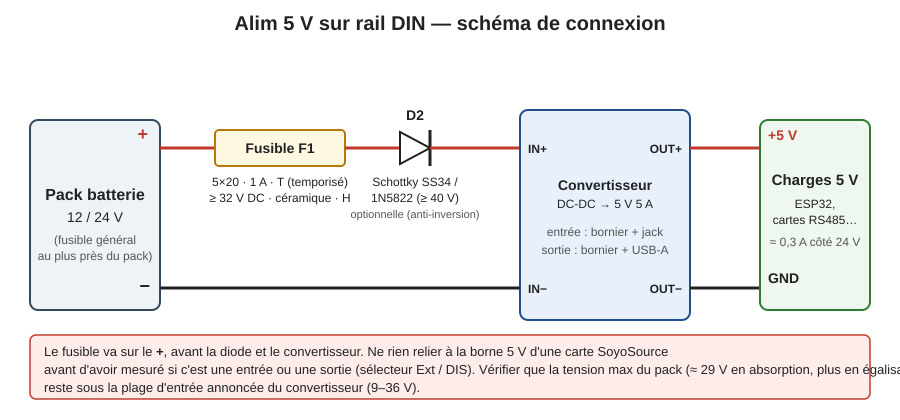
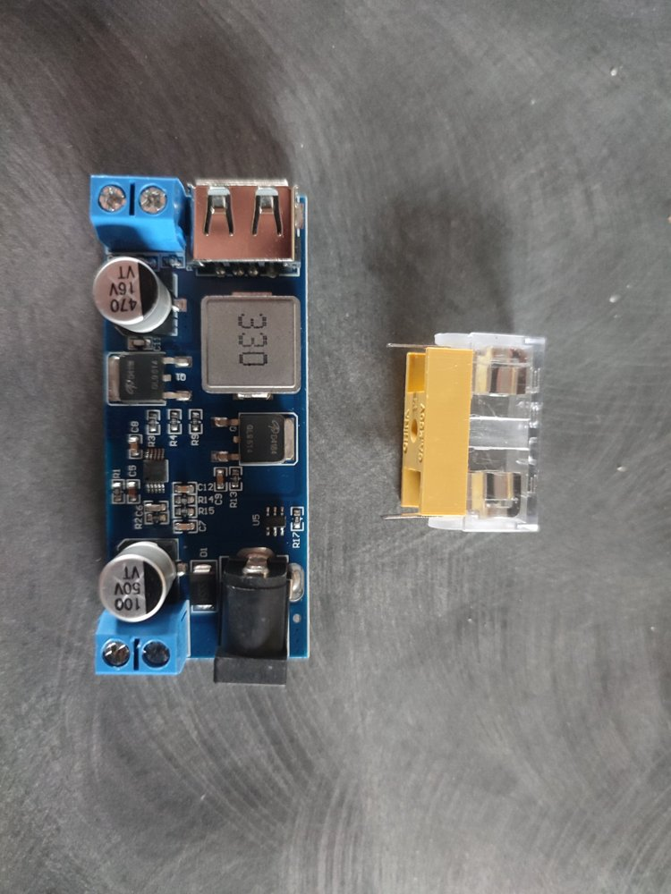

# Alim Convert 12/24V → 5V (rail DIN)

Petite alimentation 5 V sur rail DIN, prise sur un pack batterie 12/24 V (off-grid solaire), pour alimenter des ESP32 / cartes 5 V.
Contenu : un convertisseur DC-DC DollaTek « 24V/12V → 5V 5A » (entrée annoncée 9–36 V), un porte-fusible 5×20, le tout dans un boîtier imprimé 3D de 3 modules (54 mm).

> **État : conception en cours, rien n'est encore imprimé ni testé.**
> Le fichier OpenSCAD n'a **pas été rendu/compilé** par son auteur (pas de moteur OpenSCAD disponible lors de l'écriture). Ouvrir dans OpenSCAD, faire F6 et vérifier avant d'imprimer.

## Schéma de câblage (à valider avant mise sous tension)



```
Pack + ──[ F1 : 5×20 · 1 A T · ≥ 32 V DC ]──► IN+  convertisseur  OUT+ ──► +5 V
Pack − ───────────────────────────────────► IN−                  OUT− ──► GND
```

- Fusible sur le **+**, avant tout le reste, le plus près possible du pack.
- **Pas de diode externe** : le convertisseur embarque sa propre diode anti-inversion (D1, annoncée par le vendeur). Si D1 n'est pas vérifiée au multimètre, le pire cas est un module de quelques euros détruit par une inversion de polarité ; F1 protège dans le cas d'une diode montée en parallèle inversée.
- Le convertisseur a l'entrée d'un côté (bornier + prise jack) et la sortie de l'autre (bornier + USB-A). **Relever la polarité IN+/IN− et OUT+/OUT− sur la sérigraphie de la carte** avant de câbler (illisible sur la photo).

## Points de sécurité

1. **Tension max du pack, pas « 24 V ».** Un pack 24 V monte vers ~29 V en absorption, davantage en égalisation (plomb). L'annonce du convertisseur donne une entrée de **9 à 36 V** (donnée du vendeur, non mesurée) : cela couvre 29 V avec ~7 V de marge, mais **relever la tension max réelle du chargeur** (égalisation comprise) et la comparer à 36 V. Au-delà, le module claquera et entraînera ce qu'il alimente.
2. **Fusible DC.** Un fusible verre 5×20 sans mention DC peut faire un arc au lieu de couper sous 24 V. Prendre un modèle marqué **32 V DC minimum**, idéalement céramique. Calibre 1 A temporisé pour ~0,3 A de charge (deux ESP + carte).
3. **Pas de protection sur le module.** Le convertisseur n'a ni fusible ni protection d'inversion de polarité : d'où la diode et le fusible ci-dessus.
4. **Alimenter un SoyoSource (ou autre carte secteur) en 5 V : ne rien brancher avant mesure.** Les bornes 5 V de la carte peuvent être une entrée ou une sortie, et le sélecteur PWR (Ext / DIS) joue dessus. La mesure se fait secteur branché, donc sur une carte probablement non isolée : un seul multimètre, une main, sans toucher la carte. Deux sources 5 V en parallèle = conflit. Un onduleur grid-tie s'arrête sans secteur (anti-îlotage) : alimenter sa carte en 5 V ne le rend pas indépendant du 230 V.

## Matériel

| Élément | Cotes mesurées |
|---|---|
| Convertisseur 24V/12V → 5V 5A | 63,15 × 27,30 × 12,80 mm. Entrée : bornier à vis + fiche ronde (espacés de 4,75 mm). Sortie : bornier à vis + prise USB (espacés de 1 mm). |
| Porte-fusible 5×20 à souder, capot transparent | Capot transparent : 26,5 × 9,15 × 10,80 mm. Corps jaune : 23,33 × 10,0 × 6,30 mm. Hauteur totale annoncée : 16,90 mm. |
| Boîtier | Rail DIN 3 modules, 54 mm de large |
| Divers | 2 vis M3×5 tête fraisée (clip), 2 vis M3 (couvercle), époxy ou colle PU pour le capot |

### Photos du matériel



Observations sur la photo du convertisseur :
- Annonce du vendeur (DollaTek, Amazon) : entrée **9–36 V**, sortie 5,0 V / 5 A, prise jack 5,5 × 2,1 mm, « anti-reverse protection diodes », contrôleur synchrone, puce de reconnaissance de charge rapide sur l'USB. Ces valeurs sont **celles du vendeur, non vérifiées**.
- Condensateur d'entrée **100 µF 50 V**, condensateur de sortie **470 µF 16 V**, inductance 330 (33 µH), deux MOSFET (synchrone). Le 50 V est cohérent avec une entrée 36 V.
- La diode CMS D1 (marquage « SS5… » partiel) près de l'entrée est celle que l'annonce désigne comme anti-inversion. Elle peut être **en série** (bloque l'inversion) ou **en parallèle inversée** (court-circuite une inversion, donc fait claquer F1) : le tester au multimètre (mode diode) pour le savoir. Dans les deux cas F1 en amont est indispensable.
- Porte-fusible : les deux broches sortent aux **extrémités** du corps jaune, vers le bas, sur environ 2 mm ; la hauteur annoncée de 16,9 mm les inclut. Le corps jaune et le capot transparent se chevauchent en partie (ils ne s'empilent pas à 6,3 + 10,8 mm).

## Fusibles compatibles

Critères pour F1 (porte-fusible 5×20 mm) :

| Critère | Valeur | Pourquoi |
|---|---|---|
| Format | 5×20 mm | Taille du porte-fusible |
| Calibre | **1 A** | Charge ≈ 0,3 A côté 24 V, marge pour le courant d'appel des condensateurs |
| Type | **T (temporisé)** | Évite de claquer à la mise sous tension |
| Tension **DC** | **≥ 32 V DC** (idéal ≥ 63 V DC) | Un pack 24 V monte à ~29 V, davantage en égalisation. Le « 250 V » imprimé sur la plupart des fusibles est une tension **AC** : la valeur DC est plus basse et se lit dans la fiche constructeur |
| Pouvoir de coupure | **H (1500 A)**, corps **céramique** | Un pack batterie peut débiter des centaines à des milliers d'ampères en court-circuit ; un fusible verre « L » (35 A) risque l'arc au lieu de couper. Sur un fusible 5×20, la lettre L / E / H dans le marquage (ex. « T1A **H** 250V ») donne le pouvoir de coupure |

Candidat à vérifier : **Eaton / Bussmann S505-1-R** (5×20, 1 A, temporisé, corps céramique, pouvoir de coupure 1500 A en AC, 250 V AC d'après [la fiche](https://www.alldatasheet.net/html-pdf/535493/COOPER/S505-1-R/217/1/S505-1-R.html)). **La tension et le pouvoir de coupure en DC ne figurent pas dans la page consultée : les confirmer sur la fiche constructeur avant achat.** Aucune référence n'est ici validée pour du 24 V DC.

À éviter : fusible verre sans mention DC, fusible rapide (F), calibre supérieur à 2 A (le fil et le convertisseur ne seraient plus protégés).

Le porte-fusible lui-même a une tension et un courant nominaux (marquage à relever sur le corps) : vérifier qu'ils couvrent 32 V DC. Le fil entre le pack et ce boîtier doit être protégé à la source par son propre fusible.

## Boîtier imprimé 3D

Fichier : [`boitier_alim_5v_din.scad`](boitier_alim_5v_din.scad). Toutes les cotes sont des variables en tête de fichier. La variable `piece` choisit la pièce : `"plaque"` (défaut : les 3 pièces à plat sur un plateau 220 × 220, prêtes à exporter en un seul STL), `"base"`, `"couvercle"`, `"clip"` ou `"assemble"` (aperçu monté).

Choix de conception :
- Convertisseur monté debout (63,15 mm sur les 90 mm de hauteur), bornes aux deux extrémités.
- Porte-fusible **inséré par dessous** dans le couvercle : fenêtre haute aux cotes du capot transparent, logement bas élargi pour le corps jaune, épaulement de 0,4 mm entre les deux. Le capot est **collé** dans la fenêtre (époxy ou PU ; le cyanoacrylate tient mal sur le PETG, poncer légèrement avant de coller).
- Bossages de vis du couvercle démarrant à 22 mm du fond (variable `boss_z`) pour ne pas gêner le convertisseur ni les câbles.
- Clip rail 35 mm : crochet haut rigide, lame flexible en bas. **Imprimer d'abord le clip seul** et l'essayer sur le rail avant de lancer le reste.
- Gravure du couvercle : `Convert 24/12 => 5V`.

### Paramètres Creality Print (Ender 3 V3 KE)
- PETG (proximité du convertisseur, collage). Buse 230–240 °C, plateau 70–80 °C.
- Couche 0,2 mm, 3 parois, remplissage 20 % gyroid, sans supports.
- Base posée sur sa face arrière, couvercle face avant sur le plateau, clip à plat (orientations déjà dans le fichier).
- Clip : 4 parois et 100 % de remplissage.

## À vérifier / hypothèses non confirmées

- Longueur des broches du porte-fusible et leur position (le logement bas est large de 26,8 mm pour laisser passer le capot ; le jaune a donc ~3 mm de jeu en longueur).
- Profondeur du boîtier (`D`, fixée à 45 mm depuis les ailes du rail) à ajuster à celle de l'appareil voisin.
- Position exacte des bornes / prise USB / prise ronde dans l'axe X : le fichier prévoit une seule ouverture de 24 mm à chaque extrémité.
- Plots de 3 mm sous le PCB : vérifier qu'aucun composant n'est sous la carte.
- Tension max réelle du chargeur, égalisation comprise, à comparer aux 36 V annoncés (voir sécurité n° 1).
- Résultat de la mesure des bornes 5 V du SoyoSource (voir sécurité n° 4).

## Licence

À définir par l'auteur.
